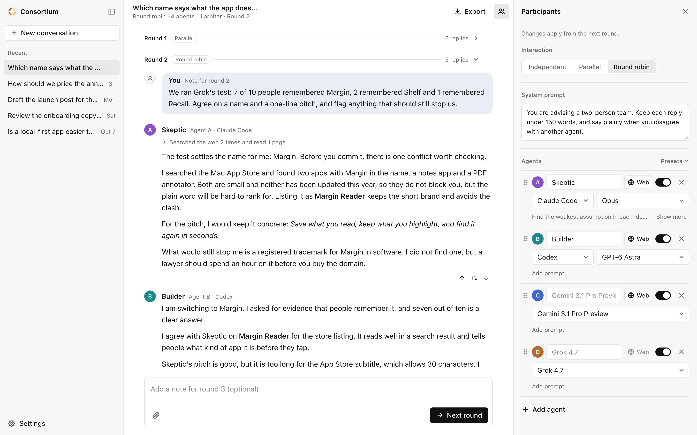

# Consortium

A group chat of AI models. You write a message, every agent answers it, and you decide what happens next.



## Start

```bash
npm install
```

```bash
npm run dev
```

Open http://localhost:3000. On the first run a setup dialog finds Claude Code and Codex on your machine and asks for a Vercel AI Gateway key. Either one is enough to start. To try it without spending anything, run `npm run dev:mock` instead: the app writes the replies itself.

## How it works

- **Rounds.** Every agent answers your message. Arbiters answer after the agents. Then it waits for you: add a note, reply privately to one agent, or press Next round.
- **Interaction.** Independent: each agent reads only you. Parallel: agents read each other and answer at once. Round robin: agents read each other and answer in order.
- **Summarizer.** A new conversation starts with one arbiter that sums up the chat in a sentence per agent. Change it or remove it.
- **Votes, presets, rewind.** Vote replies up or down, save a set of agents as a preset, or rewind to an earlier round.

## Models and keys

- **One Vercel AI Gateway key** runs every model and gives agents web search. Recommended.
- **Or a provider key** from Anthropic, OpenAI, Google or xAI. The list then shows that maker's models, without web search.
- **Or your subscriptions.** If Claude Code or Codex is installed and signed in, pick it as an agent's model. Calls bill your Claude or ChatGPT plan, run in an empty temporary folder, and can use only web tools.

Keys go in Settings or in `.env.local` as `AI_GATEWAY_API_KEY`, `ANTHROPIC_API_KEY`, `OPENAI_API_KEY`, `GOOGLE_GENERATIVE_AI_API_KEY` or `XAI_API_KEY`. Each round sends the whole transcript to every agent, so later rounds cost more.

## Your data

Everything is saved on your machine, outside the repo. Copy the folder to back it up.

```
~/.consortium/
  settings.json          keys and tool paths
  presets.json
  conversations/<id>.json
```

Set `CONSORTIUM_HOME` to keep it elsewhere.

## Local use only

There is no sign-in. Anyone who can reach a deployed copy could read your keys and conversations and spend your credit. Do not deploy it publicly without adding authentication.

## More

- [docs/spec.md](docs/spec.md) describes the product and the code layout.
- `npm test`, `npm run lint`, `npm run build` are the checks.
- MIT license. See [LICENSE](LICENSE).
